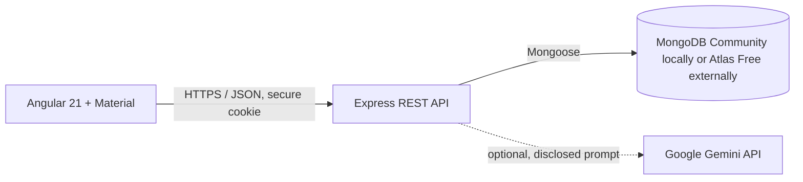

# MediTrack

MediTrack is a medication-management learning project for people who want a simple way to organize medicines, schedules, and dose history. Medication data is private to each authenticated account. It provides general education only and is not a medical device or a substitute for professional advice.

## Current implementation

- Angular 21 standalone frontend, Angular Material, TypeScript, SCSS, responsive shell and pages for dashboard, medicines, add medicine, schedule, dose history, assistant, profile, login, and registration.
- Express 4 / TypeScript API under `/api/v1`; Mongoose models for users, medicines, and dose records; password hashing; signed HTTP-only cookie; validation, rate limits, CORS, Helmet, user scoping, and account deletion.
- Schedule occurrences are stored using a unique per-user occurrence key; recorded history remains when a medicine is discontinued. Dashboard and adherence summaries query stored data.
- Assistant defaults to a deterministic FAQ. Optional Gemini integration is disabled until a server-side key is configured; it discloses external processing. Do not enter identifiable or sensitive health information. Gemini free-tier terms say submitted content may be used to improve Google products; do not use it with real patient information.
- Current AWS free-plan terms describe a time-limited new-customer plan, not permanent free hosting. No cloud resources are created by this project.

## Architecture



## Structure

```text
client/       Angular application
server/       Express API, models, routes, schedule service
docs/         architecture, API, development status, deployment guide
```

## Prerequisites and Windows setup

Use Node.js 24 LTS/current compatible with Angular CLI 21, npm, and MongoDB Community Server 8.x. Angular CLI 21.2.24 and MongoDB Community Server 8.2 were present when this project was created. From PowerShell:

1. Start MongoDB Community Server locally (service or `mongod` with its configured data directory).
2. Copy `server/.env.example` to `server/.env`; set a random `JWT_SECRET` of at least 32 characters. The default MongoDB URI points to local MongoDB.
3. In `server`: `npm install`, then `npm run dev`.
4. In `client`: `npm install`, then `npm start`.
5. Open `http://localhost:4200`, register, then add medicines using the exact directions from your prescription.

The API defaults to `http://localhost:3000/api/v1`. Configure the approved frontend origin with `CLIENT_ORIGIN`. Authentication uses a SameSite=Lax HTTP-only cookie. On HTTPS set `COOKIE_SECURE=true`. Production deployment across separate sites may require a deliberate cookie/CSRF architecture; the current local setup is not a turnkey production security review.

### Environment variables

See `server/.env.example`: `PORT`, `NODE_ENV`, `MONGODB_URI`, `JWT_SECRET`, `CLIENT_ORIGIN`, `COOKIE_SECURE`, and optional `GEMINI_API_KEY`. Never commit `.env`. The Angular API URL is currently `http://localhost:3000/api/v1` in `client/src/app/app.ts`; change it for a reviewed deployment.

## Features and limitations

Private registration/login/logout, profile/time-zone field, medicine create/list/discontinue, schedule generation, taken/skipped/missed dose status, history, adherence formula, dashboard, and FAQ fallback are implemented. Schedule uses server-local time for occurrence generation currently; true IANA time-zone/DST-correct schedule calculation, weekly view, full edit flow, reminders, interactive charts, robust CSRF protection, and production-grade session revocation are not complete. The add form deliberately accepts medicine name, prescribed dose, frequency/times, and dates only; remaining prescription fields and editing are future work. Do not use for clinical care or rely on reminders.

Adherence = taken dose records ÷ doses due in the selected range × 100. Skipped and missed doses remain in the denominator; future scheduled doses are excluded. If no doses are due the result is unavailable (`null`).

## Commands

- API dev: `cd server; npm run dev`
- Frontend dev: `cd client; npm start`
- Production builds: root `npm run build`
- Backend tests: `cd server; npm test` (schedule/adherence unit tests)
- Frontend tests: `cd client; npm test -- --watch=false` (uses the workspace `.tmp` as `TEMP`/`TMP` if Windows temp folder permissions block Vitest)
- Dependency audits: `npm --prefix server audit` and `npm --prefix client audit`
- OpenAPI definition: `server/src/openapi.ts` (JSON endpoint not yet exposed)

## Zero-cost hosting

Local demonstration with MongoDB Community Server and the FAQ fallback has no cloud or API dependency. Atlas currently offers a Free cluster with 0.5 GB and max 500 connections, subject to feature/region/network limits; only allow trusted IPs, never `0.0.0.0/0` for a real personal dataset. AWS's current Free plan for new customers ends at six months or when credits are exhausted, and eligibility is limited. It cannot support a promise of permanent ₹0 hosting. Read [docs/AWS_ZERO_COST_DEPLOYMENT.md](docs/AWS_ZERO_COST_DEPLOYMENT.md) before considering hosted demo options.

## Medical safety and privacy

The assistant offers educational guidance, not diagnosis or personal dosing. Prescription instructions and official product information take priority. Never start, stop, increase, decrease, or combine medicines based on this application. For severe symptoms, suspected overdose, or immediate danger, contact local emergency services or a poison information service. If using Gemini, prompts leave your server for Google; the free-tier content policy may use data to improve products. Keep it disabled for sensitive/real health data.
